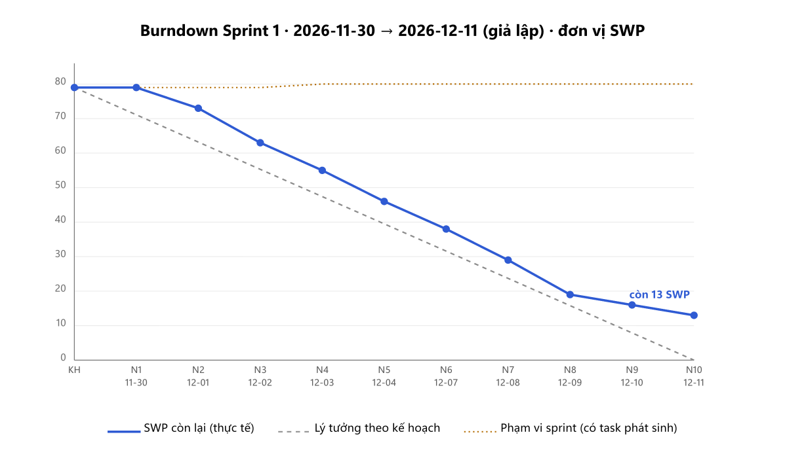

# Báo cáo tiến độ — Sprint 1

| | |
|---|---|
| Iteration trên Project | **Sprint 1** (field `Iteration` của Project *Yuki Cold Chain — Backlog (LAB-5)*) |
| Khoảng thời gian | **2026-11-30 (thứ Hai) → 2026-12-11 (thứ Sáu)**, 10 ngày làm việc. Đây là **giả lập**, ngày báo cáo là cuối ngày 2026-12-11 |
| Mục tiêu sprint | Đóng các lỗ hổng bảo mật của prototype (RLS, vai trò, audit, mã lỗi), dựng ngưỡng nhiệt có phiên bản, và làm phần lõi của engine giờ lái 2024 (H-03/04/05/06/07/10/11) |
| Nhóm | 8 người giả định, năng lực danh nghĩa 370 h/sprint; Sprint 1 xếp 258 h (70 %) vì là sprint khởi động (PREMISE A-05) |
| Nguồn số liệu | [`backlog/data.typ`](backlog/data.typ) → `tools/sprint_report.py` → [`sprint/sprint-1-daily.csv`](sprint/sprint-1-daily.csv), [`sprint/sprint-1-summary.json`](sprint/sprint-1-summary.json) |

## 1. Trạng thái

Task (leaf) của Sprint 1, khớp với field `Status` trên Project:

| Trạng thái | Số issue | Tổng SWP | Ghi chú |
|---|---|---|---|
| Done | 37 | 67 | 230 h thực tế / 219 h ước lượng (×1,05). Đã đóng trên GitHub |
| In Review | 2 | 4 | #26 AUDIT_LOG (còn 2 h), #100 khoảng vi phạm chính xác (còn 1 h) |
| In Progress | 2 | 6 | #11 bộ test RLS pgTAP (còn 5 h), #88 màn TEMP_POLICY (còn 6 h) |
| Blocked | 2 | 3 | #115 chờ pháp chế Yuki trả lời Q-15; #146 chờ Yuki xác nhận quy ước ca qua nửa đêm |
| Todo | 0 | 0 | |
| **Tổng Sprint 1** | **43** | **80** | Kế hoạch 79 SWP + 1 SWP phát sinh (#10); hoàn thành **67 SWP (84 %)**; chuyển sang Sprint 2: **13 SWP / 19 h còn lại** |

Toàn backlog cuối Sprint 1: 37/106 task Done (67/237 SWP, 28 %). Theo epic:
- EP-01 nền tảng: 34/39 SWP.
- EP-06 ngưỡng nhiệt: 8/13.
- EP-07 engine giờ lái: 13/37. Các phần H-03/04/05/06/07/10/11 đã xong, chỉ còn khoảng vi phạm chính xác đang review.
- EP-08 lập tuyến: 3/43 (mới có schema).

## 2. Burndown

| Ngày | KH | N1 | N2 | N3 | N4 | N5 | N6 | N7 | N8 | N9 | N10 |
|---|---|---|---|---|---|---|---|---|---|---|---|
| Lý tưởng (SWP) | 79 | 71 | 63 | 55 | 47 | 40 | 32 | 24 | 16 | 8 | 0 |
| Thực tế còn lại (SWP) | 79 | 79 | 73 | 63 | 55 | 46 | 38 | 29 | 19 | 16 | 13 |
| Phạm vi (SWP) | 79 | 79 | 79 | 79 | 80 | 80 | 80 | 80 | 80 | 80 | 80 |

**Lệch kế hoạch ở đâu:**
- **N1 không xong task nào.** Ngày đầu dựng môi trường Tokyo (#149) và schema, nên thực tế cách đường lý tưởng 8 SWP ngay từ đầu. Từ N2 đến N8, nhóm đốt khoảng 9 SWP/ngày, gần bằng tốc độ lý tưởng 7,9 nhưng không bù lại được khoảng cách ban đầu.
- **N4: phạm vi tăng 1 SWP.** Khi bật RLS mới thấy FK `skus.temp_band → temp_policies` chặn việc tách bảng chính sách, nên phát sinh #10 (4 h).
- **RLS tốn hơn dự kiến.** #8 và #9 vượt tổng 5 h (20 → 25 h). Hệ quả là bộ test RLS #11 bắt đầu muộn và chưa xong.
- **N8 → N10 gần như đi ngang** (19 → 13). Phần còn lại là việc chờ: 2 task Blocked vì chờ khách, và 2 task In Review dồn vào cuối sprint. #99 (thuật toán lái liên tục) xong N8, vượt 1 h so với ước lượng đã tăng sau review.
- **Tải không đều.** BE Bình 76 h thực tế trên năng lực 60 h, trong khi FE Chi 27 h và Dũng 32 h. Nguyên nhân là API của Sprint 1 chưa sẵn cho FE, nên FE chỉ làm được các màn dựa vào API đã có trong prototype.

## 3. Rủi ro trễ

| Rủi ro | Issue | Ảnh hưởng tới mốc nào | Hành động | Ai làm, khi nào |
|---|---|---|---|---|
| R-01 Pháp chế Yuki chưa trả lời Q-15 (giới hạn nào chặn công bố). Nếu trả lời khác giả định PM-08 thì phải đổi engine và bộ quy tắc | #113, #115 → #104, #128 | Hoàn tất engine giờ lái (cuối Sprint 2, 2026-12-25); công bố tuyến end-to-end (cuối Sprint 3, 2027-01-15) | Gửi lại bảng hỏi kèm 13 ví dụ, đề nghị trả lời trước kỳ nghỉ cuối năm của Nhật. Trong lúc chờ, giữ PM-08 và để mức độ BLOCK/WARN là dữ liệu của bộ quy tắc (không cần sửa code khi đổi) | Lan (BA/BrSE) gửi 2026-12-14; Khoa chốt với PM Yuki trước 2026-12-18 |
| R-02 Chưa có quy ước ca qua nửa đêm | #146 → #102, #109 | Engine giờ lái (cuối Sprint 2) | Làm #102 theo giả định A-01, viết ca biên cho cả hai cách để đổi nhanh khi có trả lời | Lan hỏi lại 2026-12-14; An làm #102 trong Sprint 2 |
| R-03 Yuki nghỉ cuối năm (khoảng 2026-12-29 → 2027-01-03), câu hỏi gửi sau ngày 2026-12-24 sẽ chờ sang tháng 1 | #113, #146, #121 | Sprint 3 bắt đầu 2027-01-04 | Gom mọi câu hỏi mở (Q-15, A-01, Q-23) vào buổi họp tuần ngày 2026-12-17 | Khoa, 2026-12-17 |
| R-04 Ước lượng bottom-up thấp hơn nhiều so với estimate lần đầu (`estimate.md` §4) | toàn backlog | Kết thúc build (P2, 2027-04-02) | Theo dõi tỷ lệ giờ thực tế / ước lượng mỗi sprint; Sprint 1 là 1,05. Nếu > 1,15 sau Sprint 2 thì ước lại toàn bộ phần còn lại và báo khách | Khoa, review sprint 2026-12-25 |
| R-05 Backend là nút cổ chai: Bình quá tải (76/60 h) và Sprint 2 lại dồn BE vào EP-07/EP-08 | #102, #103, #105, #119, #120, #122 | Engine giờ lái và API tuyến (cuối Sprint 2) | Chuyển #119 và #120 (API-RT) từ Bình sang An; Khoa nhận #106. FE dùng mock theo `api-design.md` để làm sớm #132, #134 | Khoa, planning Sprint 2 ngày 2026-12-14 |
| R-06 Bộ test RLS (#11) chưa xong, nên các tính năng Sprint 2 được dựng trên RLS chưa kiểm hết | #11 | Bảo mật trước khi demo cho Yuki (cuối Sprint 2) | Ưu tiên hoàn thành ngày đầu Sprint 2; chặn merge task có bảng mới nếu chưa có test RLS cho bảng đó | Hà, 2026-12-14 → 12-15 |
| R-07 Chưa chọn dịch vụ bản đồ (Q-23) | #121, #123, #124 | Tích hợp bản đồ thật (Sprint 4, 2027-01-29) | Nhập tay là đường chính (A-04, #122 ở Sprint 2); cần quyết định trước 2027-01-08 | Khoa, theo dõi tại họp tuần |

**Đánh giá chung:**
- Sprint 1 đạt 84 % SWP kế hoạch, velocity **67 SWP**.
- Sprint 2 đã xếp 55 SWP, cộng 13 SWP chuyển sang là 68 SWP, xấp xỉ velocity. **Không nhận thêm việc mới vào Sprint 2.**
- Các mốc chưa trễ. Rủi ro lớn nhất là R-01 và R-03, vì cả hai phụ thuộc thời gian trả lời của khách quanh kỳ nghỉ cuối năm.
